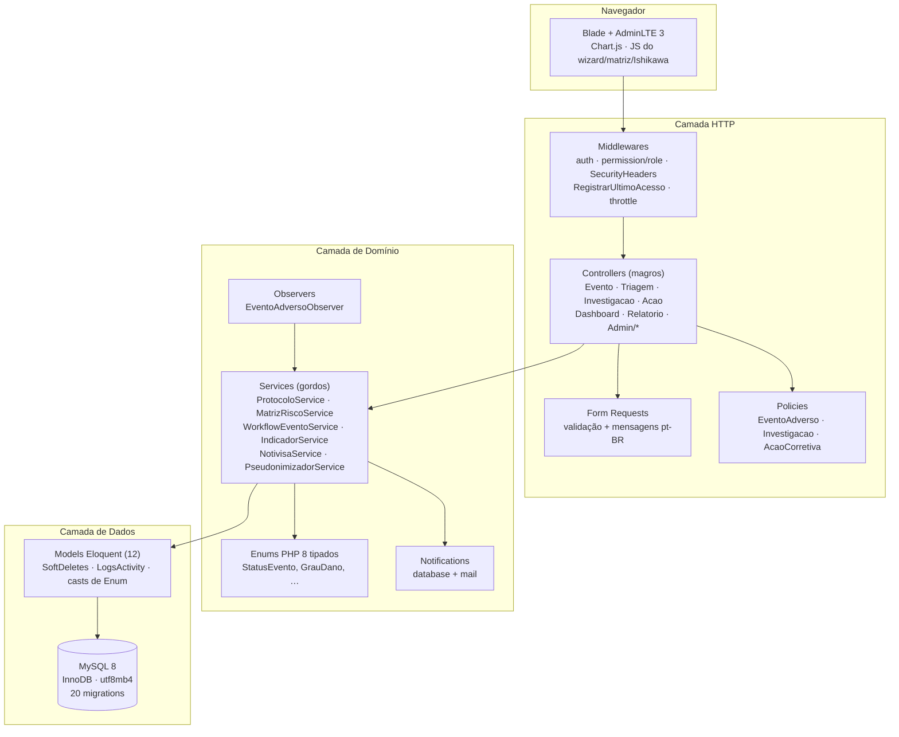
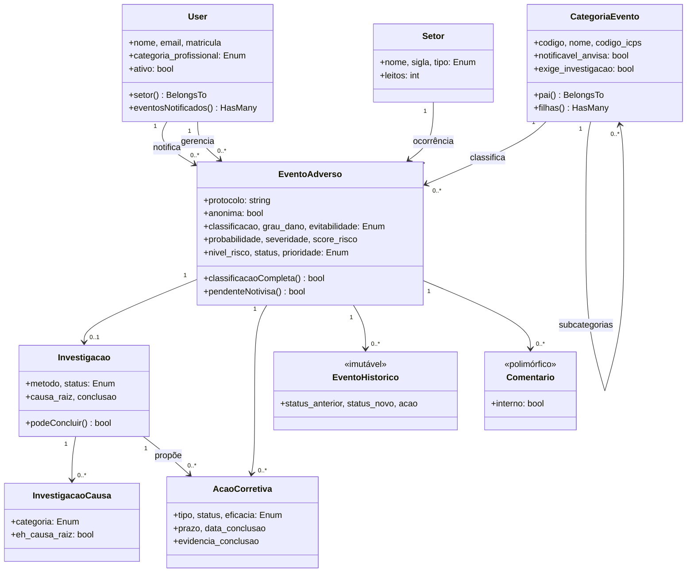
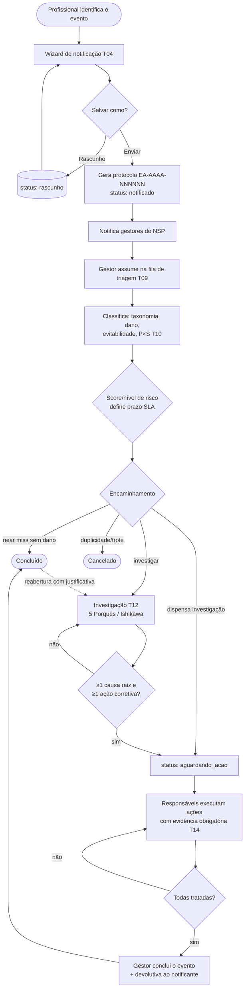
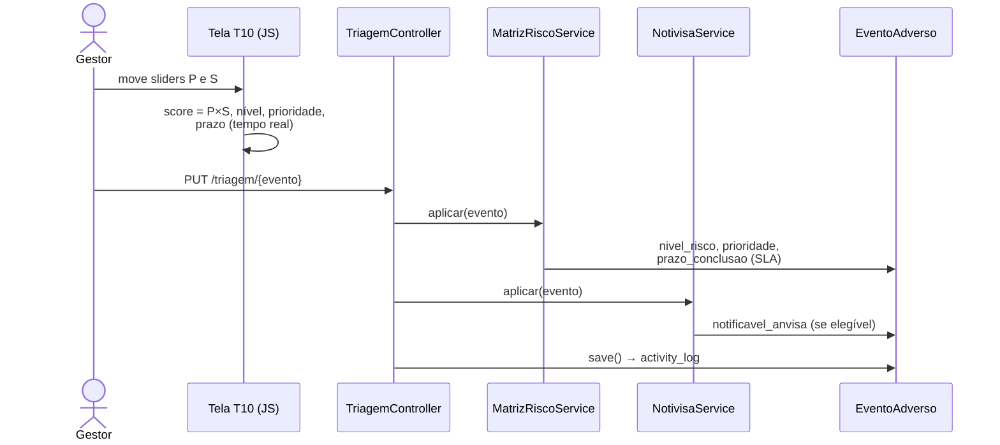

# SIGEA — Arquitetura do Sistema

## 1. Visão em camadas (MVC + Services)

**Princípios aplicados:** controllers magros → services gordos; nenhuma query no Blade;
enums sempre tipados com `label()`/`cor()`; toda listagem paginada (15/página); toda escrita
de domínio auditada.

## 2. Diagrama de classes (domínio)

## 3. Fluxo principal — notificação → conclusão (diagrama de atividade)

## 4. Fluxo da matriz de risco (triagem)

## 5. Decisões registradas

- [ADR 0001 — Pseudonimização do paciente](adr/0001-pseudonimizacao.md)
- [ADR 0002 — Taxonomia ICPS](adr/0002-taxonomia-icps.md)
- [ADR 0003 — Matriz de risco 5×5](adr/0003-matriz-risco-5x5.md)

## 6. Máquina de estados e modelo de dados

Ver [`MODELO_DADOS.md`](MODELO_DADOS.md) — DER completo, dicionário de dados e diagrama de
estados do evento adverso.
