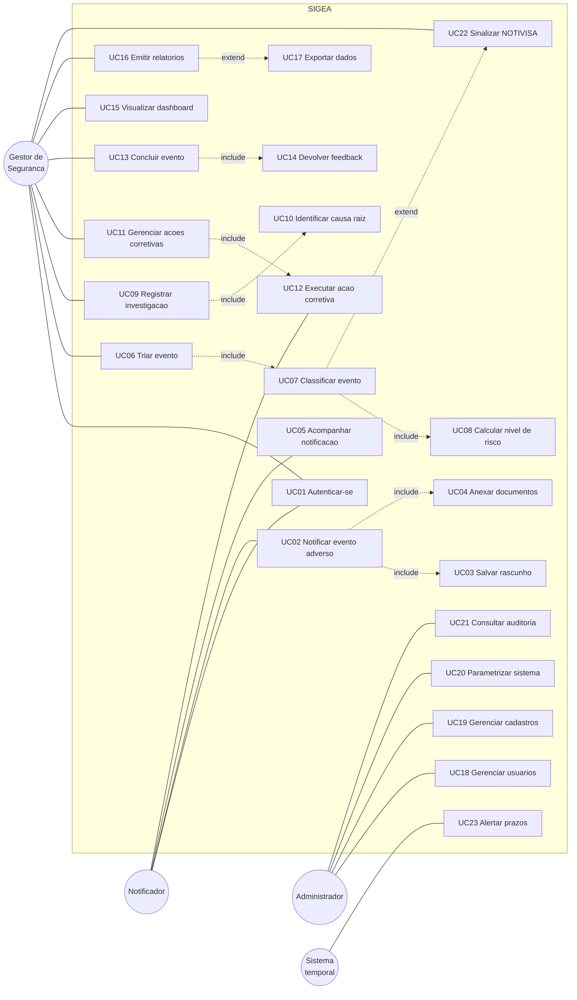

# ANEXO B — REQUISITOS DO SIGEA
## Casos de Uso, User Stories e Requisitos Funcionais

*Artefato do levantamento e análise de requisitos (objetivo específico "c" — levantar e documentar requisitos funcionais e não funcionais; Seção 5.3 da metodologia).*

Notação: UML 2.5 para o diagrama de casos de uso; formato de *user story* aderente ao Scrum; priorização pelo método MoSCoW.

---

## B.1 Atores

| Ator | Descrição | Origem do requisito |
|---|---|---|
| **Notificador** | Profissional de saúde de qualquer categoria que identifica e registra a ocorrência de um evento adverso ou quase-erro. É o ator de maior volume e menor tempo disponível. | Literatura (KANG et al., 2017; MILCH et al., 2006) |
| **Gestor de Segurança** | Membro do Núcleo de Segurança do Paciente, responsável pela triagem, classificação, investigação e tratativa dos eventos. | PNSP (BRASIL, 2013); ANVISA (2019) |
| **Administrador** | Responsável técnico pela manutenção do sistema: usuários, perfis, cadastros e parâmetros. | Requisito operacional |
| **Sistema (ator temporal)** | Rotinas agendadas que verificam prazos, alteram status de ações vencidas e emitem alertas automáticos. | Requisito derivado dos SLAs |

---

## B.2 Diagrama de casos de uso

*Observação: as relações `<<include>>` e `<<extend>>` estão representadas por linhas tracejadas rotuladas.*

---

## B.3 Especificação dos casos de uso principais

### UC02 — Notificar evento adverso

| Campo | Conteúdo |
|---|---|
| **Ator primário** | Notificador |
| **Objetivo** | Registrar a ocorrência de um evento adverso, quase-erro ou circunstância notificável |
| **Pré-condições** | Usuário autenticado com perfil que possua a permissão `evento.criar` |
| **Pós-condições** | Evento persistido com status `notificado` e número de protocolo único gerado; gestores notificados |
| **Frequência** | Alta — é o caso de uso de maior volume do sistema |

**Fluxo principal**

1. O notificador aciona "Notificar evento" no menu.
2. O sistema apresenta o assistente (*wizard*) em quatro passos.
3. Passo 1 — o notificador informa categoria do evento, data, hora, turno, setor de ocorrência e local específico.
4. Passo 2 — o notificador descreve o ocorrido, os fatores contribuintes e a ação imediata adotada.
5. Passo 3 — o notificador informa, opcionalmente, o identificador do paciente (pseudonimizado pelo sistema), a faixa etária, o sexo e os profissionais envolvidos ou testemunhas.
6. Passo 4 — o sistema apresenta o resumo para revisão; o notificador pode anexar documentos e optar pelo anonimato.
7. O notificador confirma o envio.
8. O sistema valida os dados, gera o protocolo no formato EA-AAAA-NNNNNN, persiste o registro com status `notificado`, grava a transição no histórico e notifica os gestores de segurança.
9. O sistema exibe a tela de confirmação com o protocolo em destaque.

**Fluxos alternativos**

- *FA1 — Salvar rascunho:* em qualquer passo, o notificador salva o registro com status `rascunho`, podendo retomá-lo posteriormente. Nenhum protocolo é gerado nesse momento.
- *FA2 — Notificação anônima:* ao marcar a opção de anonimato no passo 4, o sistema alerta que não haverá devolutiva e, após confirmação, persiste o registro sem vínculo com o notificante. A opção é irreversível.
- *FA3 — Categoria de notificação compulsória:* se a categoria selecionada estiver marcada como notificável à ANVISA, o sistema sinaliza o evento e exibe alerta ao gestor.

**Fluxos de exceção**

- *FE1 — Validação:* campos obrigatórios ausentes, descrição com menos de 30 caracteres ou data de ocorrência futura impedem o avanço, com mensagem explicativa no campo correspondente.
- *FE2 — Anexo inválido:* arquivo com tipo não permitido ou tamanho superior a 10 MB é rejeitado, preservando os demais dados já preenchidos.

**Requisitos de qualidade:** o preenchimento completo deve ser possível em até três minutos; o formulário deve ser plenamente operável em dispositivo móvel, uma vez que a notificação frequentemente ocorre à beira do leito.

---

### UC06 — Triar evento

| Campo | Conteúdo |
|---|---|
| **Ator primário** | Gestor de Segurança |
| **Objetivo** | Analisar a notificação recebida, validar sua classificação e definir o encaminhamento |
| **Pré-condições** | Existir evento com status `notificado`; usuário com permissão `evento.triar` |
| **Pós-condições** | Evento classificado, com nível de risco calculado, prazo definido e status atualizado |

**Fluxo principal**

1. O gestor acessa a fila de triagem, ordenada por tempo de espera, com destaque para os eventos que ultrapassaram o prazo de triagem parametrizado.
2. O gestor assume um evento, tornando-se seu responsável.
3. O sistema apresenta o relato original à esquerda e o formulário de classificação à direita.
4. O gestor revisa a categoria, define a classificação do incidente, o grau de dano e a evitabilidade.
5. O gestor atribui probabilidade e severidade em escala de 1 a 5.
6. O sistema calcula, em tempo real, o escore e o nível de risco, sugere a prioridade e preenche o prazo de conclusão conforme o SLA correspondente.
7. O gestor registra a devolutiva ao notificante e escolhe o encaminhamento.
8. O sistema persiste a classificação, grava a transição no histórico e notifica o notificante.

**Fluxos alternativos**

- *FA1 — Conclusão direta:* quando o grau de dano é `nenhum` e a classificação é `near miss` ou `circunstância notificável`, o gestor pode concluir o evento imediatamente.
- *FA2 — Dispensa de investigação:* o gestor encaminha diretamente para ações corretivas.
- *FA3 — Cancelamento:* em caso de duplicidade ou registro indevido, o gestor cancela o evento mediante justificativa obrigatória.
- *FA4 — Notificação compulsória:* o sistema mantém alerta fixo até que o protocolo do NOTIVISA seja registrado.

**Regra de negócio:** o encaminhamento para investigação é bloqueado enquanto categoria, classificação, grau de dano, evitabilidade, probabilidade e severidade não estiverem integralmente preenchidos.

---

### UC09 / UC10 — Registrar investigação e identificar causa raiz

| Campo | Conteúdo |
|---|---|
| **Ator primário** | Gestor de Segurança |
| **Objetivo** | Conduzir a análise de causa raiz do evento e documentar suas conclusões |
| **Pré-condições** | Evento com status `em_investigacao` |
| **Pós-condições** | Investigação concluída, com pelo menos uma causa raiz e uma ação corretiva associadas |

**Fluxo principal**

1. O gestor abre a investigação e seleciona o método de análise.
2. Se escolhido o método dos Cinco Porquês, o sistema apresenta campos encadeados, nos quais cada resposta origina a pergunta seguinte.
3. Se escolhido o Diagrama de Ishikawa, o sistema apresenta seis eixos — pessoa, processo, equipamento, ambiente, material e gestão — permitindo a inclusão dinâmica de causas em cada um.
4. O gestor marca as causas identificadas como raiz.
5. O sistema renderiza o diagrama a partir das causas cadastradas.
6. O gestor registra a análise, a causa raiz sintetizada e a conclusão.
7. O gestor cadastra as ações corretivas decorrentes.
8. O gestor conclui a investigação; o sistema altera o status do evento para `aguardando_acao`.

**Regra de negócio:** a conclusão da investigação é bloqueada enquanto não houver, no mínimo, uma causa marcada como raiz e uma ação corretiva cadastrada — impedindo o encerramento de análises sem desdobramento prático, limitação recorrentemente apontada na literatura sobre sistemas de notificação.

---

### UC15 — Visualizar dashboard

| Campo | Conteúdo |
|---|---|
| **Ator primário** | Gestor de Segurança |
| **Objetivo** | Monitorar indicadores de segurança do paciente e identificar padrões |
| **Pré-condições** | Permissão `dashboard.ver` |

**Fluxo principal**

1. O gestor acessa o painel.
2. O sistema apresenta quatro indicadores-síntese, cinco visualizações gráficas e a relação dos eventos mais recentes.
3. O gestor aplica filtros de período, setor, categoria e grau de dano.
4. O sistema recalcula e atualiza todas as visualizações de forma assíncrona.
5. O gestor seleciona uma célula da matriz de risco e o sistema navega para a listagem já filtrada pelo recorte correspondente.

**Indicadores apresentados:** taxa de eventos por mil pacientes-dia; taxa de evitabilidade; proporção de eventos com dano; tempo médio de triagem; tempo médio de conclusão; percentual de ações concluídas no prazo; aderência ao SLA.

**Requisito de desempenho:** carregamento completo em até dois segundos com base de seiscentos eventos.

---

## B.4 Backlog do produto — User Stories

Formato: *Como [ator], quero [funcionalidade], para que [benefício]*.
Priorização MoSCoW: **M** = obrigatório (*must have*); **S** = importante (*should have*); **C** = desejável (*could have*).

### Épico 1 — Acesso e controle

| ID | User story | Critérios de aceite | Prio. | Sprint |
|---|---|---|---|---|
| US01 | Como profissional de saúde, quero acessar o sistema com e-mail e senha institucionais, para que apenas usuários autorizados registrem ocorrências. | Login válido redireciona conforme o perfil; credencial inválida exibe mensagem genérica; cinco tentativas falhas em um minuto bloqueiam temporariamente o acesso. | M | 1 |
| US02 | Como usuário, quero recuperar minha senha por e-mail, para que eu não perca o acesso ao sistema. | Link com validade de sessenta minutos; token de uso único. | M | 1 |
| US03 | Como administrador, quero cadastrar usuários e atribuir perfis, para que o acesso seja controlado institucionalmente. | Não existe autocadastro; e-mail de boas-vindas com definição de senha; possibilidade de inativação sem exclusão. | M | 1 |
| US04 | Como administrador, quero cadastrar setores e categorias de evento, para que o sistema reflita a estrutura da instituição. | Categorias em dois níveis; impossibilidade de excluir cadastro em uso; exclusão lógica. | M | 1 |
| US05 | Como administrador, quero parametrizar prazos e regras, para que o sistema se adeque à política institucional sem necessidade de nova implantação. | Alteração de SLA reflete nos eventos criados posteriormente. | S | 1 |

### Épico 2 — Notificação

| ID | User story | Critérios de aceite | Prio. | Sprint |
|---|---|---|---|---|
| US06 | Como notificador, quero registrar um evento adverso em um formulário guiado, para que eu consiga notificar rapidamente mesmo sob pressão assistencial. | Assistente em quatro passos; conclusão em até três minutos; validação por campo. | M | 2 |
| US07 | Como notificador, quero salvar a notificação como rascunho, para que eu possa concluí-la em outro momento. | Rascunho visível apenas ao autor; sem geração de protocolo; edição e exclusão permitidas. | M | 2 |
| US08 | Como notificador, quero notificar anonimamente, para que o receio de punição não me impeça de relatar. | Ausência de vínculo com o autor no banco; aviso explícito sobre a ausência de devolutiva; irreversibilidade. | M | 2 |
| US09 | Como notificador, quero anexar documentos e imagens, para que eu evidencie o ocorrido. | Formatos PDF, JPG, PNG, DOCX e XLSX; limite de dez megabytes; armazenamento privado. | S | 2 |
| US10 | Como notificador, quero receber um número de protocolo, para que eu possa acompanhar a tratativa. | Protocolo único no formato EA-AAAA-NNNNNN; exibição em destaque com opção de cópia. | M | 2 |
| US11 | Como notificador, quero acompanhar o andamento das minhas notificações, para que eu saiba que houve providência. | Listagem restrita às próprias notificações; exibição de status e devolutiva. | M | 2 |
| US12 | Como notificador, quero receber a devolutiva do gestor, para que eu perceba o valor de notificar. | Notificação no sistema e por e-mail; devolutiva visível na tela do evento. | M | 3 |

### Épico 3 — Triagem e classificação

| ID | User story | Critérios de aceite | Prio. | Sprint |
|---|---|---|---|---|
| US13 | Como gestor, quero visualizar uma fila de triagem priorizada, para que eu trate primeiro os casos mais urgentes. | Ordenação por tempo de espera; destaque visual para prazos excedidos; ação de assumir o evento. | M | 3 |
| US14 | Como gestor, quero classificar o evento segundo taxonomia padronizada, para que os dados sejam comparáveis entre setores e períodos. | Campos de classificação, grau de dano e evitabilidade obrigatórios; rastreabilidade ao código ICPS. | M | 3 |
| US15 | Como gestor, quero que o sistema calcule o nível de risco, para que a priorização seja objetiva e reprodutível. | Cálculo em tempo real na interface; faixas conforme o Quadro A.13; prioridade sugerida automaticamente. | M | 3 |
| US16 | Como gestor, quero que o prazo de conclusão seja preenchido automaticamente, para que o acompanhamento siga a política institucional. | Prazo derivado do nível de risco; edição permitida com registro em histórico. | S | 3 |
| US17 | Como gestor, quero ser alertado sobre eventos de notificação compulsória, para que a instituição cumpra as obrigações regulatórias. | Alerta permanente até o registro do protocolo NOTIVISA; sinalização automática por categoria, grau de dano ou classificação. | S | 3 |

### Épico 4 — Investigação e ações

| ID | User story | Critérios de aceite | Prio. | Sprint |
|---|---|---|---|---|
| US18 | Como gestor, quero conduzir a análise de causa raiz por método estruturado, para que a investigação seja consistente. | Métodos dos Cinco Porquês e de Ishikawa implementados; causas categorizadas em seis eixos. | M | 4 |
| US19 | Como gestor, quero visualizar o diagrama de causa e efeito, para que a análise seja compreensível pela equipe. | Diagrama renderizado a partir das causas cadastradas; exportável junto ao relatório. | C | 4 |
| US20 | Como gestor, quero cadastrar ações corretivas com responsável e prazo, para que a análise resulte em melhoria efetiva. | Responsável e prazo obrigatórios; notificação automática ao responsável designado. | M | 4 |
| US21 | Como responsável, quero visualizar e concluir as ações sob minha responsabilidade, para que eu cumpra minhas atribuições. | Listagem pessoal de ações; conclusão condicionada ao registro de evidência. | M | 4 |
| US22 | Como gestor, quero avaliar a eficácia das ações concluídas, para que eu verifique se o problema foi efetivamente resolvido. | Classificação em eficaz, parcialmente eficaz ou ineficaz; ação ineficaz permite reabertura do evento. | S | 4 |
| US23 | Como sistema, quero marcar automaticamente as ações vencidas e alertar os responsáveis, para que os prazos sejam observados. | Rotina diária; alerta por e-mail conforme parâmetro de antecedência. | S | 4 |
| US24 | Como gestor, quero concluir o evento apenas quando todas as ações estiverem tratadas, para que não haja encerramento prematuro. | Conclusão bloqueada enquanto houver ação pendente ou em andamento. | M | 4 |

### Épico 5 — Análise e transparência

| ID | User story | Critérios de aceite | Prio. | Sprint |
|---|---|---|---|---|
| US25 | Como gestor, quero visualizar indicadores de segurança em painel, para que eu monitore o desempenho institucional. | Sete indicadores calculados; carregamento em até dois segundos com seiscentos eventos. | M | 5 |
| US26 | Como gestor, quero visualizar a distribuição dos eventos por categoria, setor, grau de dano e período, para que eu identifique padrões e concentrações. | Cinco gráficos interativos; filtros aplicáveis simultaneamente a todas as visualizações. | M | 5 |
| US27 | Como gestor, quero navegar da matriz de risco para os eventos correspondentes, para que eu investigue concentrações identificadas. | Células da matriz clicáveis, direcionando à listagem filtrada. | C | 5 |
| US28 | Como gestor, quero emitir relatórios consolidados em PDF, para que eu apresente resultados às instâncias institucionais. | Cabeçalho institucional, período, tabela de indicadores e gráficos incorporados. | M | 6 |
| US29 | Como gestor, quero exportar a base em planilha, para que eu realize análises complementares. | Exportação em CSV e XLSX respeitando os filtros aplicados; ausência de dados identificáveis. | S | 6 |
| US30 | Como administrador, quero consultar a trilha de auditoria, para que eu verifique quem alterou cada registro. | Registro de autor, data, endereço de origem e comparação entre valores anteriores e novos. | M | 6 |
| US31 | Como usuário, quero visualizar o histórico completo do evento em linha do tempo, para que a tratativa seja transparente. | Todas as transições registradas, em ordem cronológica e sem lacunas. | M | 2 |

---

## B.5 Requisitos funcionais consolidados

| ID | Requisito funcional | Origem | Objetivo específico |
|---|---|---|---|
| RF01 | O sistema deve permitir autenticação por e-mail e senha, com controle de acesso baseado em três perfis. | Análise de sistemas existentes | e |
| RF02 | O sistema deve permitir o registro estruturado de eventos adversos, contemplando tipo, gravidade, setor, profissionais envolvidos e descrição detalhada. | Metodologia, Seção 5.5 | e |
| RF03 | O sistema deve permitir a notificação anônima. | Literatura sobre subnotificação | e |
| RF04 | O sistema deve gerar número de protocolo único e sequencial por ano. | Análise comparativa (NOTIVISA) | e |
| RF05 | O sistema deve classificar os eventos segundo taxonomia padronizada, contemplando tipo, grau de dano e evitabilidade. | WHO (2009); metodologia, Seção 5.5 | e |
| RF06 | O sistema deve calcular o nível de risco a partir de matriz de probabilidade e severidade. | ANVISA (2019) | e |
| RF07 | O sistema deve implementar fluxo de trabalho para acompanhamento do ciclo de vida do evento, da notificação à conclusão. | Metodologia, Seção 5.5 | e |
| RF08 | O sistema deve permitir o registro de investigações com métodos estruturados de análise de causa raiz. | Lacuna identificada no NOTIVISA | e |
| RF09 | O sistema deve permitir o cadastro e o acompanhamento de ações corretivas, com responsável, prazo e avaliação de eficácia. | Metodologia, Seção 5.5 | e |
| RF10 | O sistema deve apresentar painéis de visualização com gráficos e indicadores de segurança. | Metodologia, Seção 5.5 | f |
| RF11 | O sistema deve permitir a emissão de relatórios em PDF e a exportação de dados em planilha. | Requisito de gestão | f |
| RF12 | O sistema deve manter trilha de auditoria de todas as operações de escrita. | Requisito regulatório | e |
| RF13 | O sistema deve sinalizar eventos elegíveis à notificação compulsória à ANVISA e registrar o protocolo correspondente. | ANVISA; PNSP | e |
| RF14 | O sistema deve emitir notificações internas e por correio eletrônico nas transições de estado e no vencimento de prazos. | Requisito operacional | e |
| RF15 | O sistema deve permitir o anexo de documentos comprobatórios, com armazenamento privado. | Requisito operacional | e |
| RF16 | O sistema deve permitir a devolutiva ao notificante sobre a tratativa do evento. | Literatura sobre cultura de segurança | e |
| RF17 | O sistema deve permitir a parametrização de prazos e regras institucionais. | Requisito de manutenibilidade | e |
| RF18 | O sistema deve permitir a gestão de usuários, setores e categorias de evento. | Requisito operacional | e |

## B.6 Requisitos não funcionais

| ID | Requisito não funcional | Categoria | Verificação |
|---|---|---|---|
| RNF01 | O sistema deve ser desenvolvido em arquitetura MVC utilizando o framework Laravel. | Arquitetura | Inspeção de código |
| RNF02 | O sistema deve utilizar o SGBD MySQL, com esquema definido por meio de migrações. | Persistência | Inspeção |
| RNF03 | A interface deve ser responsiva, plenamente operável em dispositivos móveis. | Usabilidade | Teste em três resoluções |
| RNF04 | O painel de indicadores deve ser carregado em até dois segundos com base de seiscentos eventos. | Desempenho | Medição |
| RNF05 | O sistema deve implementar proteção contra injeção de SQL, XSS e CSRF. | Segurança | Teste de penetração básico |
| RNF06 | As senhas devem ser armazenadas com função de hash criptográfica adequada. | Segurança | Inspeção |
| RNF07 | O sistema não deve armazenar dados identificáveis de pacientes; os identificadores devem ser pseudonimizados. | Privacidade | Inspeção do banco |
| RNF08 | A interface deve estar integralmente em português brasileiro. | Usabilidade | Inspeção |
| RNF09 | O sistema deve atender às dez heurísticas de usabilidade de Nielsen. | Usabilidade | Avaliação heurística |
| RNF10 | A cobertura de testes automatizados deve alcançar, no mínimo, setenta por cento nas camadas de serviço e controle. | Qualidade | Relatório de cobertura |
| RNF11 | O contraste dos elementos de interface deve atender ao nível AA das diretrizes WCAG 2.1. | Acessibilidade | Verificação automatizada |
| RNF12 | O sistema deve ser instalável a partir da documentação, sem intervenção do desenvolvedor. | Manutenibilidade | Teste de instalação em ambiente limpo |
| RNF13 | O código-fonte deve ser versionado com Git, com mensagens de commit descritivas. | Processo | Inspeção do repositório |
| RNF14 | O sistema deve operar exclusivamente com dados simulados durante o desenvolvimento e a validação. | Ética | Inspeção |

---

## B.7 Rastreabilidade entre objetivos específicos e requisitos

| Objetivo específico do TCC | Requisitos atendidos |
|---|---|
| (c) Levantar e documentar requisitos funcionais e não funcionais | Todo este Anexo B |
| (d) Projetar a arquitetura e o modelo de dados | RNF01, RNF02; Anexo A |
| (e) Desenvolver a plataforma com registro, classificação e acompanhamento | RF01 a RF09, RF12 a RF18 |
| (f) Implementar painéis de visualização e análise | RF10, RF11, RNF04 |
| (g) Realizar testes funcionais e de usabilidade | RNF09, RNF10, RNF11 |
| (h) Avaliar o potencial da ferramenta como apoio à gestão | Critérios de aceite globais do plano de desenvolvimento |

---

*Anexo elaborado conforme a Seção 5.3 da metodologia, com base em revisão bibliográfica, análise comparativa de soluções existentes (NOTIVISA, RL Datix e Riskonnect) e requisitos regulatórios da ANVISA e do Programa Nacional de Segurança do Paciente.*
