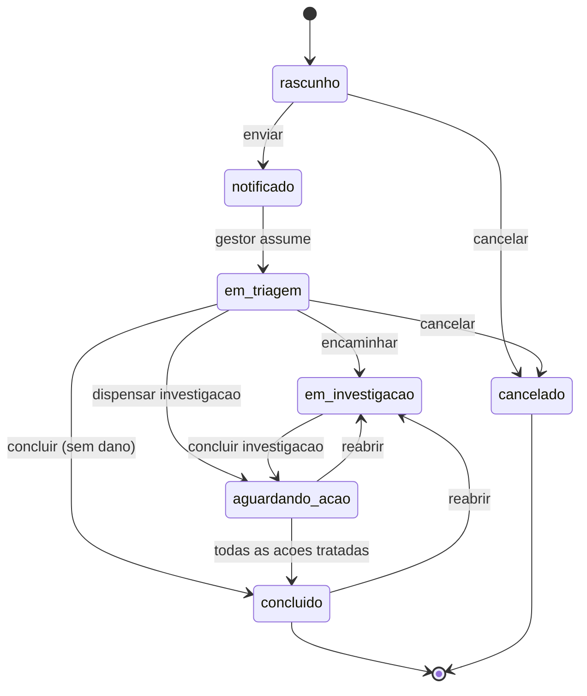

# ANEXO A — MODELO DE DADOS DO SIGEA
## Dicionário de Dados e Diagrama Entidade-Relacionamento

*Artefato do projeto do sistema (objetivo específico "d" — projetar a arquitetura da aplicação web e o modelo de dados da plataforma).*

SGBD: MySQL 8.0 · Engine InnoDB · Charset `utf8mb4` · Collation `utf8mb4_unicode_ci`

---

## A.1 Visão geral das entidades

O modelo é composto por **16 tabelas de domínio**, agrupadas em quatro blocos funcionais:

| Bloco | Tabelas |
|---|---|
| Controle de acesso | `users`, `roles`, `permissions`, `model_has_roles`, `role_has_permissions` |
| Cadastros básicos | `setores`, `categorias_evento`, `configuracoes` |
| Núcleo do evento adverso | `eventos_adversos`, `evento_profissionais`, `evento_anexos`, `evento_historico` |
| Tratativa e apoio | `investigacoes`, `investigacao_causas`, `acoes_corretivas`, `comentarios`, `activity_log` |

---

## A.2 Diagrama Entidade-Relacionamento

```mermaid
erDiagram
    USERS ||--o{ EVENTOS_ADVERSOS : "notifica"
    USERS ||--o{ EVENTOS_ADVERSOS : "gerencia"
    USERS ||--o{ INVESTIGACOES : "conduz"
    USERS ||--o{ ACOES_CORRETIVAS : "executa"
    USERS ||--o{ COMENTARIOS : "escreve"
    USERS ||--o{ EVENTO_PROFISSIONAIS : "participa"
    USERS }o--|| SETORES : "lotado em"
    USERS }o--o{ ROLES : "possui"
    ROLES }o--o{ PERMISSIONS : "concede"

    SETORES ||--o{ EVENTOS_ADVERSOS : "local de ocorrencia"
    SETORES ||--o{ ACOES_CORRETIVAS : "responsavel"

    CATEGORIAS_EVENTO ||--o{ CATEGORIAS_EVENTO : "subcategoria de"
    CATEGORIAS_EVENTO ||--o{ EVENTOS_ADVERSOS : "classifica"

    EVENTOS_ADVERSOS ||--o| INVESTIGACOES : "origina"
    EVENTOS_ADVERSOS ||--o{ ACOES_CORRETIVAS : "gera"
    EVENTOS_ADVERSOS ||--o{ EVENTO_PROFISSIONAIS : "envolve"
    EVENTOS_ADVERSOS ||--o{ EVENTO_ANEXOS : "possui"
    EVENTOS_ADVERSOS ||--o{ EVENTO_HISTORICO : "registra"
    EVENTOS_ADVERSOS ||--o{ COMENTARIOS : "recebe"

    INVESTIGACOES ||--o{ INVESTIGACAO_CAUSAS : "identifica"
    INVESTIGACOES ||--o{ ACOES_CORRETIVAS : "propoe"

    USERS {
        bigint id PK
        varchar nome
        varchar email UK
        varchar password
        varchar matricula UK
        varchar registro_conselho
        enum categoria_profissional
        varchar cargo
        bigint setor_id FK
        boolean ativo
        timestamp ultimo_acesso_em
    }

    SETORES {
        bigint id PK
        varchar nome
        varchar sigla UK
        enum tipo
        bigint responsavel_id FK
        smallint leitos
        boolean ativo
    }

    CATEGORIAS_EVENTO {
        bigint id PK
        varchar codigo UK
        varchar nome
        text descricao
        bigint categoria_pai_id FK
        varchar codigo_icps
        boolean notificavel_anvisa
        boolean exige_investigacao
        boolean ativo
    }

    EVENTOS_ADVERSOS {
        bigint id PK
        varchar protocolo UK
        bigint notificante_id FK
        boolean anonima
        bigint categoria_evento_id FK
        bigint setor_ocorrencia_id FK
        date data_ocorrencia
        time hora_ocorrencia
        enum turno
        text descricao
        text fatores_contribuintes
        text acao_imediata
        varchar paciente_codigo
        enum paciente_faixa_etaria
        enum classificacao
        enum grau_dano
        enum evitabilidade
        tinyint probabilidade
        tinyint severidade
        tinyint score_risco
        enum nivel_risco
        enum status
        enum prioridade
        bigint gestor_responsavel_id FK
        date prazo_conclusao
        text feedback_notificante
        boolean notificavel_anvisa
        varchar protocolo_notivisa
    }

    EVENTO_PROFISSIONAIS {
        bigint id PK
        bigint evento_adverso_id FK
        bigint user_id FK
        varchar nome_externo
        enum categoria_profissional
        enum papel
    }

    EVENTO_ANEXOS {
        bigint id PK
        bigint evento_adverso_id FK
        bigint user_id FK
        varchar nome_original
        varchar caminho
        varchar mime
        int tamanho
    }

    EVENTO_HISTORICO {
        bigint id PK
        bigint evento_adverso_id FK
        bigint user_id FK
        varchar status_anterior
        varchar status_novo
        varchar acao
        text observacao
        timestamp created_at
    }

    INVESTIGACOES {
        bigint id PK
        bigint evento_adverso_id FK UK
        bigint responsavel_id FK
        enum metodo
        date data_inicio
        date data_conclusao
        text causa_raiz
        text conclusao
        enum status
    }

    INVESTIGACAO_CAUSAS {
        bigint id PK
        bigint investigacao_id FK
        enum categoria
        text descricao
        tinyint ordem
        boolean eh_causa_raiz
    }

    ACOES_CORRETIVAS {
        bigint id PK
        bigint evento_adverso_id FK
        bigint investigacao_id FK
        varchar titulo
        text descricao
        enum tipo
        bigint responsavel_id FK
        bigint setor_id FK
        date prazo
        date data_conclusao
        enum status
        enum eficacia
        text evidencia_conclusao
    }

    COMENTARIOS {
        bigint id PK
        varchar comentavel_type
        bigint comentavel_id
        bigint user_id FK
        text corpo
        boolean interno
    }

    CONFIGURACOES {
        bigint id PK
        varchar chave UK
        text valor
        enum tipo
        varchar grupo
        varchar descricao
    }
```

---

## A.3 Dicionário de dados

### Quadro A.1 — `users` (usuários do sistema)

| Atributo | Tipo | Nulo | Chave | Descrição |
|---|---|---|---|---|
| id | BIGINT UNSIGNED | Não | PK | Identificador único |
| nome | VARCHAR(150) | Não | | Nome completo do profissional |
| email | VARCHAR(150) | Não | UK | E-mail institucional; credencial de acesso |
| email_verified_at | TIMESTAMP | Sim | | Data de verificação do e-mail |
| password | VARCHAR(255) | Não | | Senha cifrada com bcrypt |
| matricula | VARCHAR(30) | Sim | UK | Matrícula funcional |
| registro_conselho | VARCHAR(30) | Sim | | Registro em conselho de classe (CRM, COREN, CRF) |
| categoria_profissional | ENUM | Não | | medico, enfermeiro, tecnico_enfermagem, farmaceutico, fisioterapeuta, nutricionista, psicologo, administrativo, outro |
| cargo | VARCHAR(100) | Sim | | Cargo ou função |
| setor_id | BIGINT UNSIGNED | Sim | FK → setores | Setor de lotação |
| telefone | VARCHAR(20) | Sim | | Ramal ou celular |
| ativo | BOOLEAN | Não | | Indica se o acesso está habilitado (default true) |
| ultimo_acesso_em | TIMESTAMP | Sim | | Data/hora do último login |
| remember_token | VARCHAR(100) | Sim | | Token "lembrar-me" |
| created_at / updated_at / deleted_at | TIMESTAMP | Sim | | Controle temporal e exclusão lógica |

### Quadro A.2 — `setores` (setores hospitalares)

| Atributo | Tipo | Nulo | Chave | Descrição |
|---|---|---|---|---|
| id | BIGINT UNSIGNED | Não | PK | Identificador |
| nome | VARCHAR(120) | Não | | Denominação do setor |
| sigla | VARCHAR(15) | Não | UK | Sigla (ex.: UTI-A, CC, PS) |
| tipo | ENUM | Não | | clinico, cirurgico, uti, emergencia, ambulatorial, diagnostico, apoio, administrativo |
| responsavel_id | BIGINT UNSIGNED | Sim | FK → users | Responsável pelo setor |
| leitos | SMALLINT UNSIGNED | Sim | | Nº de leitos; denominador do indicador de eventos por 1.000 pacientes-dia |
| ativo | BOOLEAN | Não | | Setor em operação |
| created_at / updated_at / deleted_at | TIMESTAMP | Sim | | |

### Quadro A.3 — `categorias_evento` (taxonomia de eventos, base ICPS/OMS)

| Atributo | Tipo | Nulo | Chave | Descrição |
|---|---|---|---|---|
| id | BIGINT UNSIGNED | Não | PK | Identificador |
| codigo | VARCHAR(15) | Não | UK | Código hierárquico (ex.: MED, MED.01) |
| nome | VARCHAR(150) | Não | | Denominação da categoria |
| descricao | TEXT | Sim | | Definição operacional e exemplos |
| categoria_pai_id | BIGINT UNSIGNED | Sim | FK → categorias_evento | Autorrelacionamento; NULL indica categoria-raiz |
| codigo_icps | VARCHAR(20) | Sim | | Correspondência com a *International Classification for Patient Safety* (WHO, 2009) |
| notificavel_anvisa | BOOLEAN | Não | | Sinaliza notificação compulsória ao NOTIVISA |
| exige_investigacao | BOOLEAN | Não | | Força abertura de investigação na triagem |
| ativo | BOOLEAN | Não | | |
| created_at / updated_at / deleted_at | TIMESTAMP | Sim | | |

**Categorias-raiz implementadas:** MED (medicação e fluidos intravenosos), CIR (procedimento cirúrgico ou invasivo), QUE (queda), IRA (infecção relacionada à assistência à saúde), IDE (identificação do paciente), DIS (dispositivos e equipamentos médicos), SAN (sangue e hemoderivados), NUT (dieta e nutrição), OXI (oxigênio e gases medicinais), LPP (lesão por pressão), DOC (documentação e prontuário), LAB (laboratório e diagnóstico), GES (gestão organizacional e recursos).

### Quadro A.4 — `eventos_adversos` (entidade central)

| Atributo | Tipo | Nulo | Chave | Descrição |
|---|---|---|---|---|
| id | BIGINT UNSIGNED | Não | PK | Identificador |
| protocolo | VARCHAR(20) | Não | UK | Número de protocolo no formato EA-AAAA-NNNNNN |
| notificante_id | BIGINT UNSIGNED | Sim | FK → users | Autor da notificação; NULL em notificações anônimas |
| anonima | BOOLEAN | Não | | Indica notificação anônima (irreversível) |
| categoria_evento_id | BIGINT UNSIGNED | Não | FK → categorias_evento | Tipo do evento segundo a taxonomia |
| setor_ocorrencia_id | BIGINT UNSIGNED | Não | FK → setores | Setor onde o evento ocorreu |
| setor_notificante_id | BIGINT UNSIGNED | Sim | FK → setores | Setor de origem da notificação |
| data_ocorrencia | DATE | Não | | Data do evento (não pode ser futura) |
| hora_ocorrencia | TIME | Sim | | Hora aproximada |
| turno | ENUM | Não | | manha, tarde, noite, nao_informado |
| local_especifico | VARCHAR(150) | Sim | | Localização detalhada (leito, sala) |
| descricao | TEXT | Não | | Relato factual do ocorrido (mín. 30 caracteres) |
| fatores_contribuintes | TEXT | Sim | | Circunstâncias que favoreceram o evento |
| acao_imediata | TEXT | Sim | | Providência adotada no momento |
| paciente_envolvido | BOOLEAN | Não | | Indica se houve paciente envolvido |
| paciente_codigo | VARCHAR(64) | Sim | | Identificador **pseudonimizado** (hash SHA-256 truncado) |
| paciente_faixa_etaria | ENUM | Sim | | neonato, lactente, infantil, adolescente, adulto, idoso |
| paciente_sexo | ENUM | Sim | | feminino, masculino, nao_informado |
| classificacao | ENUM | Não | | circunstancia_notificavel, near_miss, incidente_sem_dano, evento_adverso, never_event |
| grau_dano | ENUM | Não | | nenhum, leve, moderado, grave, obito (escala WHO/ICPS) |
| evitabilidade | ENUM | Não | | evitavel, provavelmente_evitavel, provavelmente_inevitavel, inevitavel, nao_avaliado |
| probabilidade | TINYINT UNSIGNED | Sim | | Escala 1–5 da matriz de risco |
| severidade | TINYINT UNSIGNED | Sim | | Escala 1–5 da matriz de risco |
| score_risco | TINYINT UNSIGNED | Sim | | Coluna gerada: probabilidade × severidade (1–25) |
| nivel_risco | ENUM | Sim | | baixo, moderado, alto, extremo |
| status | ENUM | Não | | rascunho, notificado, em_triagem, em_investigacao, aguardando_acao, concluido, cancelado |
| prioridade | ENUM | Não | | baixa, media, alta, critica |
| gestor_responsavel_id | BIGINT UNSIGNED | Sim | FK → users | Gestor de segurança responsável pela tratativa |
| prazo_conclusao | DATE | Sim | | Prazo derivado do SLA associado ao nível de risco |
| feedback_notificante | TEXT | Sim | | Devolutiva ao notificante (combate à subnotificação) |
| notificavel_anvisa | BOOLEAN | Não | | Elegível a notificação compulsória |
| notificado_anvisa_em | DATE | Sim | | Data da notificação ao NOTIVISA |
| protocolo_notivisa | VARCHAR(50) | Sim | | Protocolo retornado pelo NOTIVISA |
| triado_em / investigado_em / concluido_em | TIMESTAMP | Sim | | Marcos temporais para cálculo de indicadores |
| created_at / updated_at / deleted_at | TIMESTAMP | Sim | | |

**Índices:** `protocolo` (UNIQUE); simples em `status`, `data_ocorrencia`, `setor_ocorrencia_id`, `categoria_evento_id`, `grau_dano`, `notificante_id`; compostos em `(status, prazo_conclusao)` e `(data_ocorrencia, setor_ocorrencia_id)`.

### Quadro A.5 — `evento_profissionais`

| Atributo | Tipo | Nulo | Chave | Descrição |
|---|---|---|---|---|
| id | BIGINT UNSIGNED | Não | PK | |
| evento_adverso_id | BIGINT UNSIGNED | Não | FK CASCADE | Evento relacionado |
| user_id | BIGINT UNSIGNED | Sim | FK → users | Profissional cadastrado no sistema |
| nome_externo | VARCHAR(150) | Sim | | Profissional não cadastrado (obrigatório se user_id nulo) |
| categoria_profissional | ENUM | Não | | Ver Quadro A.1 |
| papel | ENUM | Não | | envolvido, testemunha, notificante |

### Quadro A.6 — `evento_anexos`

| Atributo | Tipo | Nulo | Chave | Descrição |
|---|---|---|---|---|
| id | BIGINT UNSIGNED | Não | PK | |
| evento_adverso_id | BIGINT UNSIGNED | Não | FK CASCADE | |
| user_id | BIGINT UNSIGNED | Sim | FK → users | Quem realizou o upload |
| nome_original | VARCHAR(255) | Não | | Nome do arquivo enviado |
| caminho | VARCHAR(255) | Não | | Caminho em armazenamento privado |
| mime | VARCHAR(100) | Não | | Tipo MIME validado |
| tamanho | INT UNSIGNED | Não | | Tamanho em bytes (máx. 10.485.760) |

### Quadro A.7 — `evento_historico` (trilha do workflow)

| Atributo | Tipo | Nulo | Chave | Descrição |
|---|---|---|---|---|
| id | BIGINT UNSIGNED | Não | PK | |
| evento_adverso_id | BIGINT UNSIGNED | Não | FK CASCADE | |
| user_id | BIGINT UNSIGNED | Sim | FK → users | Autor da transição |
| status_anterior | VARCHAR(30) | Sim | | Estado de origem |
| status_novo | VARCHAR(30) | Não | | Estado de destino |
| acao | VARCHAR(60) | Não | | Rótulo da ação executada |
| observacao | TEXT | Sim | | Justificativa (obrigatória em cancelamento e reabertura) |
| created_at | TIMESTAMP | Não | | Registro imutável (sem update nem delete) |

### Quadro A.8 — `investigacoes`

| Atributo | Tipo | Nulo | Chave | Descrição |
|---|---|---|---|---|
| id | BIGINT UNSIGNED | Não | PK | |
| evento_adverso_id | BIGINT UNSIGNED | Não | FK UK CASCADE | Relação 1:1 com o evento |
| responsavel_id | BIGINT UNSIGNED | Não | FK → users | Gestor condutor da análise |
| metodo | ENUM | Não | | cinco_porques, ishikawa, protocolo_londres, analise_simplificada |
| data_inicio | DATE | Não | | |
| data_prevista | DATE | Sim | | Prazo previsto |
| data_conclusao | DATE | Sim | | |
| descricao_analise | TEXT | Sim | | Desenvolvimento da análise |
| causa_raiz | TEXT | Sim | | Síntese da causa raiz identificada |
| conclusao | TEXT | Sim | | Conclusão e recomendações |
| status | ENUM | Não | | aberta, em_andamento, concluida, cancelada |
| created_at / updated_at / deleted_at | TIMESTAMP | Sim | | |

### Quadro A.9 — `investigacao_causas`

| Atributo | Tipo | Nulo | Chave | Descrição |
|---|---|---|---|---|
| id | BIGINT UNSIGNED | Não | PK | |
| investigacao_id | BIGINT UNSIGNED | Não | FK CASCADE | |
| categoria | ENUM | Não | | pessoa, processo, equipamento, ambiente, material, gestao (eixos do diagrama de Ishikawa) |
| descricao | TEXT | Não | | Descrição da causa |
| ordem | TINYINT UNSIGNED | Não | | Sequência (usada no método dos 5 Porquês) |
| eh_causa_raiz | BOOLEAN | Não | | Marca a causa como raiz |

### Quadro A.10 — `acoes_corretivas`

| Atributo | Tipo | Nulo | Chave | Descrição |
|---|---|---|---|---|
| id | BIGINT UNSIGNED | Não | PK | |
| evento_adverso_id | BIGINT UNSIGNED | Não | FK CASCADE | |
| investigacao_id | BIGINT UNSIGNED | Sim | FK SET NULL | Investigação que originou a ação |
| titulo | VARCHAR(180) | Não | | |
| descricao | TEXT | Não | | Detalhamento da ação |
| tipo | ENUM | Não | | corretiva, preventiva, melhoria, treinamento, barreira |
| responsavel_id | BIGINT UNSIGNED | Não | FK → users | Executor |
| setor_id | BIGINT UNSIGNED | Sim | FK → setores | Setor executor |
| prazo | DATE | Não | | Data limite |
| data_conclusao | DATE | Sim | | |
| status | ENUM | Não | | pendente, em_andamento, concluida, atrasada, cancelada |
| eficacia | ENUM | Não | | nao_avaliada, eficaz, parcialmente_eficaz, ineficaz |
| evidencia_conclusao | TEXT | Sim | | Comprovação da execução (obrigatória na conclusão) |
| created_at / updated_at / deleted_at | TIMESTAMP | Sim | | |

### Quadro A.11 — `comentarios` (relacionamento polimórfico)

| Atributo | Tipo | Nulo | Chave | Descrição |
|---|---|---|---|---|
| id | BIGINT UNSIGNED | Não | PK | |
| comentavel_type | VARCHAR(255) | Não | | Classe da entidade comentada |
| comentavel_id | BIGINT UNSIGNED | Não | | Identificador da entidade |
| user_id | BIGINT UNSIGNED | Não | FK → users | Autor |
| corpo | TEXT | Não | | Texto do comentário |
| interno | BOOLEAN | Não | | Se verdadeiro, visível apenas a gestores e administradores |

### Quadro A.12 — `configuracoes`

| Atributo | Tipo | Nulo | Chave | Descrição |
|---|---|---|---|---|
| id | BIGINT UNSIGNED | Não | PK | |
| chave | VARCHAR(80) | Não | UK | Identificador do parâmetro |
| valor | TEXT | Não | | Valor armazenado |
| tipo | ENUM | Não | | string, inteiro, booleano, json |
| grupo | VARCHAR(40) | Não | | Agrupamento na interface |
| descricao | VARCHAR(255) | Sim | | Explicação do parâmetro |

**Parâmetros:** `sla_triagem_horas` (48), `sla_investigacao_dias` (30), `sla_acao_dias` (60), `permite_notificacao_anonima` (true), `nome_instituicao`, `dias_alerta_prazo` (7), `taxa_ocupacao_estimada` (0,8).

---

## A.4 Matriz de risco (probabilidade × severidade)

O nível de risco é derivado do produto entre probabilidade e severidade, ambas em escala de 1 a 5, resultando em um escore de 1 a 25.

### Quadro A.13 — Classificação do nível de risco

| Escore | Nível de risco | Prioridade | Prazo de conclusão (SLA) |
|---|---|---|---|
| 1 a 4 | Baixo | Baixa | 60 dias |
| 5 a 9 | Moderado | Média | 45 dias |
| 10 a 15 | Alto | Alta | 30 dias |
| 16 a 25 | Extremo | Crítica | 15 dias |

Eventos com grau de dano *grave* ou *óbito*, ou classificados como *never event*, recebem prioridade crítica independentemente do escore calculado.

---

## A.5 Máquina de estados do evento adverso



---

## A.6 Decisão de projeto: pseudonimização do paciente

O sistema não armazena nome, CPF ou número real de prontuário. O identificador do paciente é convertido, no momento da gravação, em um hash SHA-256 truncado, prefixado por `PAC-`. Essa abordagem preserva a capacidade analítica de agrupar eventos recorrentes envolvendo o mesmo paciente, sem armazenar dado pessoal identificável — atendendo aos princípios de minimização e anonimização da Lei Geral de Proteção de Dados Pessoais e aos requisitos éticos de pesquisa que motivaram, no presente trabalho, a utilização exclusiva de dados simulados.

---

*Anexo elaborado como parte do projeto do sistema descrito na Seção 5.4 da metodologia.*
